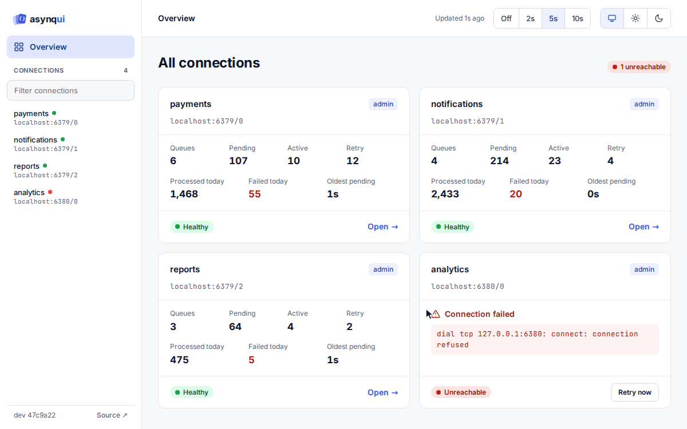

<div align="center">

<picture>
  <source media="(prefers-color-scheme: dark)" srcset="docs/images/logo-dark.svg">
  
</picture>

<p>A web dashboard for <a href="https://github.com/hibiken/asynq">asynq</a> across many Redis and Valkey instances and databases.</p>

[](https://github.com/BarkinBalci/asynqui/actions/workflows/ci.yml) [](https://github.com/BarkinBalci/asynqui/releases) [](go.mod) [](LICENSE)



</div>

Status: under active development towards v0.1.0.

## Features

- Many Redis or Valkey instances and logical databases from one deployment, with an overview across all of them
- Login with basic auth, reverse-proxy headers or OIDC
- Roles per connection for users and groups
- A single static binary or a container image

## Quickstart

Start from [config.example.yaml](config.example.yaml). It loads as is, with no
login and the read-only `viewer` role. Set `authz.default: admin` for full
control without login, or configure an auth provider.

### Binary

Download an archive for your platform from
[Releases](https://github.com/BarkinBalci/asynqui/releases), check it against
`checksums.txt`, then:

```sh
cp config.example.yaml asynqui.yaml   # edit connections
./asynqui -config asynqui.yaml        # http://localhost:8080
```

### Docker

The image reads its config from `/etc/asynqui/config.yaml` and runs as a
non-root user:

```sh
docker run --rm -p 8080:8080 \
  -v "$PWD/asynqui.yaml:/etc/asynqui/config.yaml:ro" \
  ghcr.io/barkinbalci/asynqui:latest
```

Inside a container, `localhost` is the container itself, so point
`connections[].addr` at a reachable Redis or Valkey host.

### Kubernetes

See [deployment](docs/deployment.md) for a Deployment and Service with probes
and graceful shutdown.

## Configuration

| Setting | Flag | Env | Config key | Default |
|---|---|---|---|---|
| Config file | `-config` | `ASYNQUI_CONFIG` | — | `asynqui.yaml` |
| Listen address | `-addr` | `ASYNQUI_ADDR` | `server.addr` | `:8080` |
| Log level | `-log-level` | `ASYNQUI_LOG_LEVEL` | `log.level` | `info` |

`asynqui -version` prints the version.

Precedence is flag > env > file > default. Any other value can come from the
environment through `${NAME}` or `${NAME:-default}` in the YAML. Every key is
listed in [requirements §8](docs/requirements.md#8-configuration).

asynqui checks GitHub for a newer release at startup and then daily, and shows a
dot next to the version in the sidebar. Set `update_check: false` to turn it off.

## Health probes

Both live under `server.base_path`:

- `GET /health/liveness`: 200 while the process runs.
- `GET /health/readiness`: 200 while serving, 503 from the start of shutdown.
  It never depends on Redis health.

On SIGTERM, readiness turns 503 for `server.shutdown_delay` (5s) before the
listener closes, then in-flight requests get 10s to finish. Keep
`terminationGracePeriodSeconds` above the sum. See
[deployment](docs/deployment.md).

## Development

Needs Go 1.27+. Tools are pinned in `tools/go.mod`. Tasks run with
[Task](https://taskfile.dev/installation/), or without installing it as
`go tool -modfile=tools/go.mod task`.

```sh
task              # list tasks
task run          # localhost:6379, no login, admin (config.dev.yaml)
task build        # bin/asynqui, version from git describe
task docker       # asynqui:dev image from source (Dockerfile.dev)
task lint test
task test-race    # needs cgo and a C compiler
task check        # the CI check job
task e2e          # browser tests
task demo-gif     # regenerate docs/images/demo.gif
```

The browser tests and the demo GIF need Chromium and a throwaway Redis; see
[contributing](docs/contributing.md).

## Documentation

- [Requirements](docs/requirements.md)
- [Architecture](docs/architecture.md)
- [Deployment](docs/deployment.md)
- [Contributing](docs/contributing.md)

## License

[MIT](LICENSE)
