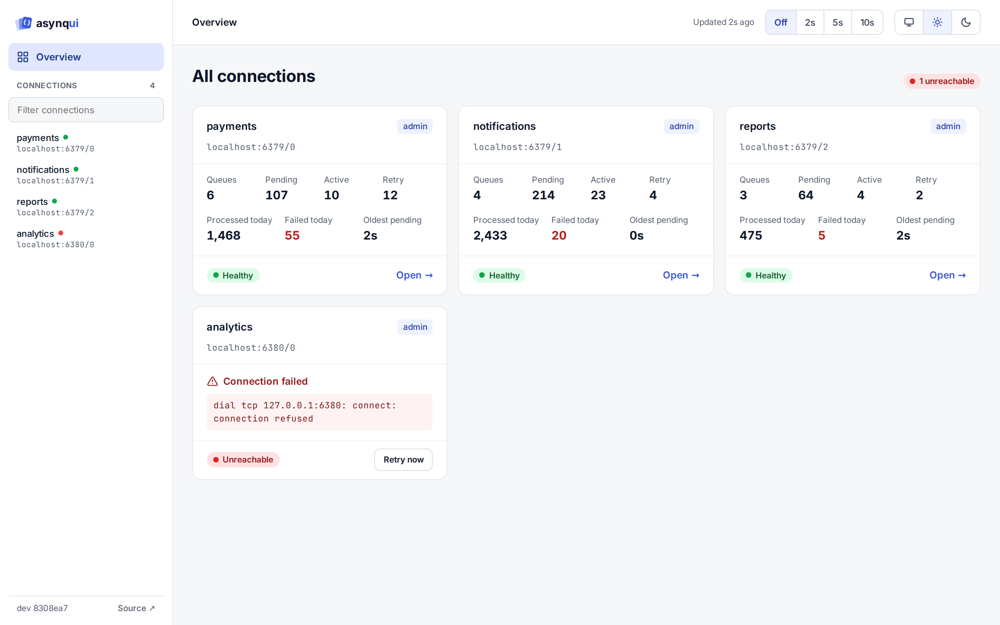
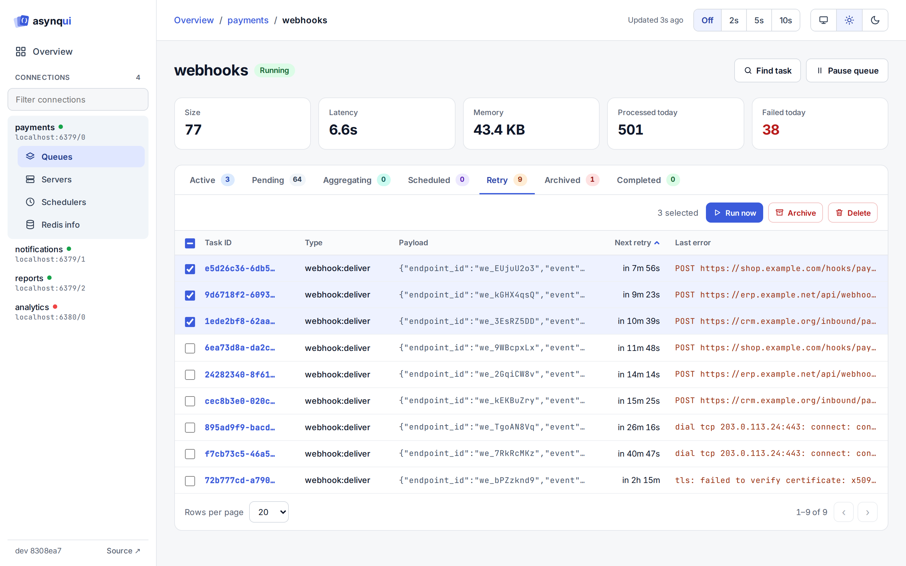
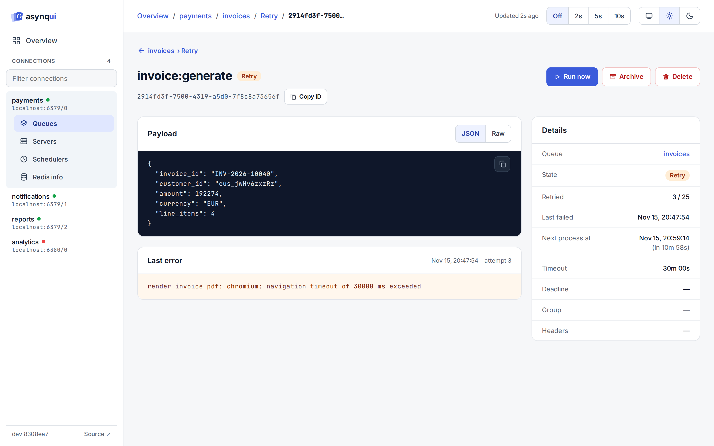
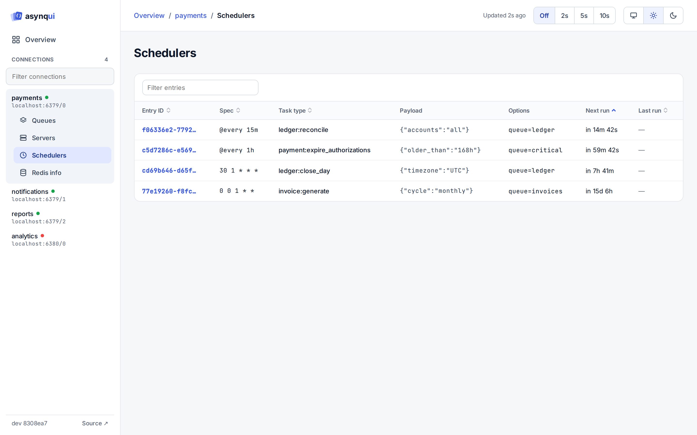

<div align="center">

<picture>
  <source media="(prefers-color-scheme: dark)" srcset="docs/images/logo-dark.svg">
  
</picture>

<p>An <a href="https://github.com/hibiken/asynq">asynq</a> dashboard for all your Redis and Valkey instances.</p>

[](https://github.com/BarkinBalci/asynqui/actions/workflows/ci.yml) [](https://github.com/BarkinBalci/asynqui/releases) [](go.mod) [](LICENSE)


</div>

## Features

- Sign in with basic auth, reverse-proxy headers or OIDC
- Roles per connection for users and groups
- A single static binary or a container image

## Quickstart

Start from [config.example.yaml](config.example.yaml). It works as is: there
is no login, and everyone gets the read-only `viewer` role. For full control
without login, set `authz.default: admin`, or configure an auth provider.

### Binary

Download an archive for your platform from
[Releases](https://github.com/BarkinBalci/asynqui/releases), check it against
`checksums.txt`, then:

```sh
cp config.example.yaml asynqui.yaml   # edit connections
./asynqui -config asynqui.yaml        # http://localhost:8080
```

### Docker

The image reads its config from `/etc/asynqui/config.yaml`:

```sh
docker run --rm -p 8080:8080 \
  -v "$PWD/asynqui.yaml:/etc/asynqui/config.yaml:ro" \
  ghcr.io/barkinbalci/asynqui:latest
```

Inside a container, `localhost` is the container itself, so point
`connections[].addr` at a reachable Redis or Valkey host.

### Kubernetes

See the [deployment example](docs/deployment.md#kubernetes-example).

## Screenshots

<table>
  <tr>
    <td width="50%" align="center">
      <a href="docs/images/overview.png"></a>
      <br>Overview
    </td>
    <td width="50%" align="center">
      <a href="docs/images/queue.png"></a>
      <br>Queue
    </td>
  </tr>
  <tr>
    <td width="50%" align="center">
      <a href="docs/images/task.png"></a>
      <br>Task
    </td>
    <td width="50%" align="center">
      <a href="docs/images/schedulers.png"></a>
      <br>Schedulers
    </td>
  </tr>
</table>

## Limitations

- Standalone Redis or Valkey only: no Sentinel or Cluster.
- No metrics endpoint and no audit log.
- Connections are managed in the config file, not in the UI.
- Only empty queues can be deleted. There is no force delete.
- Active tasks can be cancelled only by selecting them. There is no "Cancel all".
- asynq caps the archive at 10,000 tasks and 90 days.
- Scheduler entries are read-only, so there is no "run now".

## Configuration

Every flag, environment variable and config key is in [docs/configuration.md](docs/configuration.md).
asynqui checks GitHub for new releases. You can [turn the update check off](docs/deployment.md#update-check).

## Documentation

**Using**

- [Configuration](docs/configuration.md): flags, environment and every config key
- [Authentication](docs/authentication.md): providers, sessions, roles and cookies
- [Deployment](docs/deployment.md): install, Kubernetes, probes and reverse proxies

**Contributing**

- [Contributing](CONTRIBUTING.md): local development and the dev workflow
- [Design](docs/design.md): design decisions and why
- [Architecture](docs/architecture.md): how the code is organised
- [Releasing](docs/releasing.md): cutting a release

## License

[MIT](LICENSE)
